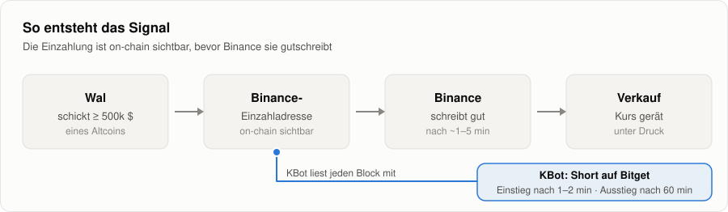
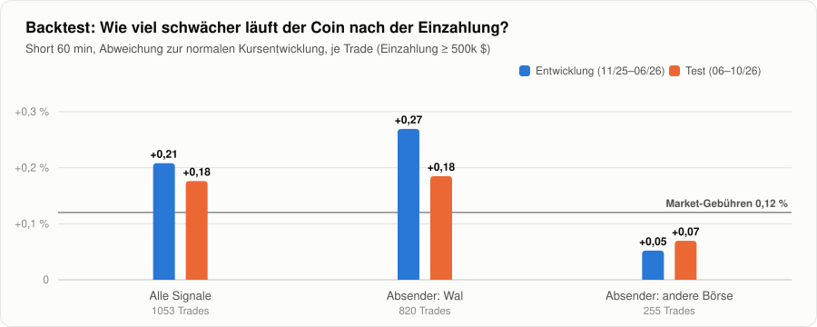
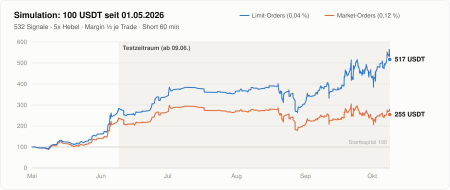

<p align="center">
  
</p>

> 🚧 **Baustelle:** Dieser Bot ist aktuell **nicht live** und wird weiterentwickelt.

# KBot — Wal-Einzahlungen auf Binance → Short auf Bitget

KBot liest live die Ethereum-Blockchain und erkennt, wenn ein Wal einen Altcoin in großer Menge
**auf Binance einzahlt**. Wer 500.000 $ eines Coins an eine Börse schickt, will ihn meist verkaufen.
KBot eröffnet dann einen **Short auf Bitget für 60 Minuten**.

> **Status: Dry-Run (Paper-Trading).** Es werden keine echten Orders platziert. Der Live-Modus ist
> gesperrt, bis der Vorwärtstest die Backtest-Ergebnisse bestätigt.

---

## Warum das funktionieren kann

<picture>
  <source media="(prefers-color-scheme: dark)" srcset="docs/img/flow-dark.svg">
  
</picture>

- Die Einzahlung ist auf der Blockchain sichtbar, **bevor** Binance sie gutschreibt und der Wal verkaufen kann.
- Binance-Einzahladressen sind nicht beschriftet. KBot lernt sie selbst: Jede Adresse, die Coins an die
  Binance-Sammel-Wallet *Binance 14* (`0x28c6…1d60`) weiterleitet („Sweep“), ist eine Einzahladresse.
  Gezählt werden nur Einzahlungen an Adressen, die **vorher** schon bekannt waren, genau wie im Backtest.
- Bitget läuft Binance nachweislich hinterher (eigener Lead-Lag-Test, 41 Coins, 90 Tage).

## Belege: präregistrierter Backtest

Die Regel wurde **vor** dem Ansehen der Kurse festgelegt und eingefroren
([`research/cex/PRAEREGISTRIERUNG.md`](research/cex/PRAEREGISTRIERUNG.md), SHA-256 `504b4591…`).

**Daten:** 22 ERC-20-Altcoins, 10/2025 bis 10/2026, 16.547 Einzahlungen an bekannte Binance-Adressen,
davon 1.513 ≥ 500k $ (~3 Signale pro Tag).
**Regel:** Einzahlung ≥ 500k $ → Short, Einstieg 1–2 min nach dem Block, Ausstieg nach 60 min.

| | Entwicklung (11/2025–06/2026) | Test (06–10/2026) |
|---|---|---|
| Trades | 655 | 398 |
| Coin schlechter als normal | **+0,21 %** (t = 2,9) | **+0,18 %** (t = 2,3) |
| gegen BTC (marktneutral) | +0,23 % (t = 3,6) | +0,21 % (t = 3,0) |
| Short netto nach 0,12 % Taker-Gebühr | +0,10 % | +0,03 % |

<picture>
  <source media="(prefers-color-scheme: dark)" srcset="docs/img/backtest-dark.svg">
  
</picture>

**Ergebnis: bestanden**, alle vorab festgelegten Kriterien erfüllt. Weitere Prüfungen
([`robust.py`](research/cex/robust.py)): Der Effekt kommt nicht von einem einzelnen Coin, bleibt beim
Zusammenfassen gleichzeitiger Ereignisse signifikant und tritt **nur bei Wal-Absendern** auf.
Verschiebungen Börse → Binance (z. B. von Coinbase) zeigen keinen Effekt.

### Simulation 100 USDT, 01.05.–08.10.2026 (532 Signale, Margin ⅓ je Trade)

| Hebel | Market-Orders (0,12 %) | Limit-Orders (0,04 %)* |
|---|---|---|
| 1x | 124 USDT, Max-DD −9 % | 143 USDT, Max-DD −8 % |
| 3x | 183 USDT, Max-DD −26 % | 281 USDT, Max-DD −22 % |
| **5x** | 255 USDT, Max-DD −40 % | **517 USDT, Max-DD −34 %** ← Dry-Run-Einstellung |

<picture>
  <source media="(prefers-color-scheme: dark)" srcset="docs/img/equity-dark.svg">
  
</picture>

\* *Limit-Orders unter der Annahme, dass jede Order gefüllt wird. Genau das misst der Dry-Run jetzt live.*

**Ehrliche Einordnung:** Der Effekt ist echt, aber klein (~0,2 % brutto pro Trade). Mit
Market-Orders entstand fast der ganze Gewinn im Mai und Juni, danach lief die Kurve seitwärts.
Mit Limit-Orders ging es auch im Testzeitraum weiter aufwärts. **Die Gebühren entscheiden.**
Ob Limit-Orders in der Praxis so gefüllt werden, kann nur der Live-Test zeigen.

## Was der Dry-Run macht

- Scannt jeden Ethereum-Block (Abfragen à max. 10 Blöcke, Alchemy Free Tier), lernt Sweeps und erkennt Einzahlungen.
- Bewertet jede Einzahlung mit dem Bitget-Kurs und wendet die Regel aus
  [`deposit_signal.py`](src/kbot/strategy/deposit_signal.py) an. Der Backtest nutzt **dieselbe Funktion**.
- Führt **zwei Paper-Konten** parallel, Start je 100 USDT, 5x Hebel, Margin ⅓:
  - **Limit:** Sell-Limit am Ask. Gefüllt nur, wenn der Kurs ihn innerhalb von 2 min erreicht, sonst „verpasst“.
    Ausstieg per Buy-Limit am Bid, falls nicht gefüllt per Market. Maker 0,02 % je Seite.
  - **Market:** Einstieg am Bid, Ausstieg am Ask, Taker 0,06 % je Seite. Dient als Vergleich.
  - Liquidation wird geprüft: Höchstkurs im Trade ≥ Einstieg × (1 + 0,9 / Hebel).
- **Telegram:** Meldung bei jedem Short und Ausstieg (beide Konten) sowie ein Tagesbericht um 07:00 UTC,
  jeweils mit aktuellem Kontostand beider Paper-Konten und Zahl der offenen Shorts.

Geprüft: Der Live-Scanner findet dieselben Einzahlungen wie die Backtest-Daten (9/9, identische Mengen).

## Installation (MiniPC / VPS)

Voraussetzung: Linux (Ubuntu/Debian) mit `sudo`; `install.sh` installiert Python 3.12, legt `.venv` an und lädt die Pakete.

```bash
git clone https://github.com/Youra82/kbot.git ~/kbot
cd ~/kbot
./install.sh
```

**1. `secret.json` anlegen** (nicht versioniert):
```bash
nano ~/kbot/secret.json
```
```json
{
    "alchemy_api_key": "dein-alchemy-key",
    "telegram": { "bot_token": "...", "chat_id": "..." }
}
```
- **Alchemy** (kostenlos, nötig): https://www.alchemy.com → Konto anlegen → „Create new app“ → Chain **Ethereum**,
  Netzwerk **Mainnet** → den **API Key** kopieren. Der Free Tier reicht.
- **Telegram** ist optional (gleicher Bot/Chat wie bei den anderen Bots möglich).
- **Bitget-Schlüssel braucht der KBot nicht** – er handelt nur auf Papier und nutzt öffentliche Kurse.

**2. `settings.json` prüfen:** `"echtgeld": {"aktiv": false}` (Standard, `true` wird abgelehnt) und `"mode": "deposits"`.
`papier_startkapital` = Startkapital je Papierkonto (Standard 100 USDT, gilt nur für ein neues Konto).

**3. Wächter-Cronjob eintragen** (`crontab -e`, ganz unten anfügen):
```cron
# kbot -> Wächter, startet den Dauerprozess falls er nicht läuft
*/5 * * * * /usr/bin/flock -n /home/<user>/kbot/kbot.lock /bin/sh -c "cd /home/<user>/kbot && .venv/bin/python3 master_runner.py >> logs/stdout.log 2>&1"
```
`<user>` durch den eigenen Benutzernamen ersetzen (`echo $USER`). Der KBot ist ein **Dauerprozess**: `flock` hält die
Sperre, solange er läuft – der Cronjob prüft also nur alle 5 Minuten, ob er noch lebt, und startet ihn sonst neu
(nach Absturz, Update oder Neustart des Rechners). Wer nicht warten will, startet ihn einmal sofort mit derselben Zeile:
```bash
cd ~/kbot && nohup /usr/bin/flock -n kbot.lock .venv/bin/python3 master_runner.py >> logs/stdout.log 2>&1 &
```

**4. Erster Start:** KBot baut einmalig das Binance-Adressbuch aus 60 Tagen Sweeps auf (**ca. 20–40 min**,
Telegram: „baue Binance-Adressbuch auf …“). Danach: „▶️ KBOT Dry-Run gestartet“. In dieser Zeit zeigt das Cockpit
„veraltet“ – das ist normal.

**Cockpit:** Liegt `~/kbot` neben `~/cockpit`, erscheint der KBot automatisch unter „Papierkonten“ (spätestens nach
10 Minuten oder sofort nach `cd ~/cockpit && ./update.sh`). Angezeigt wird das **Market-Konto** (Taker, jedes Signal
gefüllt); das Limit-Konto (Maker) steht als Vergleich darüber.

## Bedienung

| Befehl | Was er tut |
|---|---|
| `tail -f ~/kbot/logs/kbot.log` | laufendes Protokoll (Signale, Paper-Shorts, Ausstiege) |
| `cat ~/kbot/logs/paper_shorts.csv` | alle Paper-Trades beider Konten |
| `cat ~/kbot/logs/deposits.csv` | alle Binance-Einzahlungen ≥ 100k $ mit Signal-Status |
| `pgrep -af "kbot.*master_runner"` | läuft er? |
| `kill $(cat ~/kbot/artifacts/state/kbot.pid)` | anhalten (der Cron-Wächter startet ihn binnen 5 min neu; dauerhaft stoppen: Cron-Zeile auskommentieren) |
| `cd ~/kbot && ./update.sh` | neue Version holen; `secret.json`, Zustand und Trades bleiben; der Bot wird beendet und vom Wächter mit dem neuen Code neu gestartet |

## Einstellungen (`settings.json` → `deposit_watch`)

| Schlüssel | Standard | Bedeutung |
|---|---|---|
| `min_usd` | 500000 | Mindestgröße der Einzahlung in $ |
| `hold_minutes` | 60 | Haltedauer des Shorts |
| `start_equity_usdt` | 100 | Paper-Startkapital je Konto |
| `leverage` | 5 | Hebel |
| `margin_fraction` | 0.3333 | Anteil des Kapitals als Margin je Trade (bis zu 3 gleichzeitig) |
| `limit_fill_minutes` | 2 | Zeitfenster, in dem eine Limit-Order gefüllt sein muss |
| `backfill_days` | 60 | Sweep-Historie für das Adressbuch beim ersten Start |
| `tokens` | 22 Coins | LINK UNI AAVE LDO ENA ONDO PENDLE CRV ETHFI PEPE SHIB FET COMP SNX GRT IMX SAND MANA APE ENS WLD 1INCH |

`mode`: `deposits` (Standard) oder `bridge` (alter Bridge-Ansatz, widerlegt, siehe unten).
Die Standardwerte entsprechen der präregistrierten Primärvariante. Werden sie geändert, gilt der Backtest nicht mehr.

## Dateien

| Datei | Inhalt |
|---|---|
| `logs/kbot.log` | Bot-Log |
| `logs/paper_shorts.csv` | jeder Paper-Trade (beide Konten), Einstieg, Ausstieg, Status, PnL, Kontostand |
| `logs/deposits.csv` | alle Einzahlungen ≥ 100k $ an Binance mit Signal-Status |
| `artifacts/state/` | Adressbuch, Scanner-Position, offene Positionen (übersteht Neustarts) |

## Tests

```bash
.venv/bin/python3 -m pytest -q tests/
```

15 Offline-Tests: Signalregel, Adressbuch-Lernen, Sweep- und Einzahlungs-Erkennung, Limit-Füllung,
verpasster Einstieg, Liquidation, Bridge-Scanner.

## Forschung (reproduzierbar)

| Ordner | Hypothese | Ergebnis |
|---|---|---|
| [`research/cex/`](research/cex/) | Wal-Einzahlung auf Binance → Coin fällt | **bestanden** (siehe oben) |
| [`research/`](research/) (`PREREG.md`) | Stablecoin-Bridge-Zufluss → Ziel-Coin steigt (ursprüngliche KBot-Idee) | widerlegt (0/27 Varianten) |
| [`research/`](research/) (`PREREG_MINTS.md`) | Neu gedruckte Stablecoins → BTC/ETH steigen | widerlegt |

Die ursprüngliche Bridge-Version hatte falsche Bridge-Adressen, eine tote News-API (CryptoPanic v1) und
eine Simulation ohne Ausstiege. Sie ist als `mode: bridge` nur noch als Archiv enthalten.

Daten neu erzeugen: `python research/cex/collect.py` (~2 h, Alchemy Free Tier), danach `python research/cex/test.py`.
Grafiken neu erzeugen: `python research/cex/make_figures.py` (schreibt `docs/img/*.svg`, hell + dunkel).

---

### ⚠️ Disclaimer

Dieses Projekt dient ausschließlich zu Bildungs- und Forschungszwecken und ist keine Finanzberatung.
Backtests garantieren keine zukünftigen Ergebnisse. Trading mit gehebelten Krypto-Futures kann zum
Totalverlust führen.
